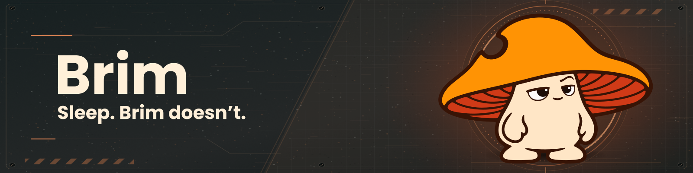

<p align="center"></p>

# Brim

[Brim](https://brim.thomkr.com/#/front) is a fast, all-in-one Discord security and moderation bot written in [Rust](https://rust-lang.org/). It stops raids, nukes and spam within seconds, puts back what an attacker broke, and keeps a full record of everything that happens on your server. Every setting lives in a clean web dashboard, so you never have to memorise a command. Every feature is free: no premium tier and no paywall.

## Why Brim

- **Built in Rust**: one small process, low memory use and no garbage-collector pauses, so it reacts while an attack is still happening.
- **Undo for everything**: optional backups every 3 hours that you can browse as a channel tree with roles, automatic revert of deleted channels and roles, and a log entry for every action it takes.
- **Staff without dangerous rights**: moderators work through permits instead of Discord permissions, so a hacked staff account can do little and everything it does can be reverted.
- **Survives restarts**: timed locks, temp bans and half-finished reverts pick up where they stopped.
- **Everything free**: every feature, for every server.

## Features

- **Anti-nuke and panic mode**: limits on mass bans, kicks, channel, role and webhook changes, with quarantine, automatic revert and a short panic lockdown. A nuking bot stays in the server with its role emptied and in quarantine, channels it made are sanitized, and every panic sends one report of who was contained and what was restored.
- **Automod**: a heat system that scores every message for spam, mentions, links, invites, caps, emojis and more, catches coordinated spam across accounts, reads QR codes in images to stop account-stealing login codes, and punishes with escalating strikes.
- **Join gate and join raid**: screen new accounts and bots, log every join gate punishment with the reason and who added a bot, and lock the server when a raid starts.
- **Moderation**: ban, kick, timeout, warn and quarantine by mention, name, tag or id. A raw id or name asks Yes/No first, the member gets a DM before the punishment (one switch), and every result shows what worked, what failed and whether the DM arrived. Sticky roles (optional) give a rejoining member their safe roles back, so leaving does not shed a Muted role.
- **More protection**: a catch channel (a honeypot: whoever writes in it is punished, since hacked accounts spam every channel), auto slowmode for a flooding channel, voice raid detection and limits on mass voice disconnects and moves, protected log channels that are made again when deleted, an NSFW image scan that runs on Brim's own server, and auto-dehoist (removes symbols at the start of names). The Raider List (off by default) acts on raider accounts the bot owner confirmed from reports of several servers.
- **Lockdown**: lock one channel, a category or the whole server, on a timer if you like, and unlock exactly what was locked.
- **Verification**: captcha in Discord or on the web. The time limit pauses while a member is timed out, and a deleted verification channel is rebuilt. Whoever deleted it is quarantined, except that Extra Owners and Trusted Admins get one warning first and the server owner only gets a DM.
- **Logging**: message, member, role, channel, voice and moderation logs in tidy embeds, sent only to private log channels.
- **Purge, invites and stats**: purge recent messages by user, type, role or text; Invite Tracking with `/invites` (who invited whom, a leaderboard and personal invite links); moderator stats on the dashboard; and a welcome message when Brim joins a server.
- **Appeals, reports and cases**: ban and timeout appeals, a report button for members, a searchable case history, and staff notes with their full edit history (a server-wide sweep always asks first).
- **Tickets, embeds and Discord AutoMod**: members DM Brim to open a ticket with any server they share with it, staff answer in a private channel (anonymous replies, snippets, greeting and closing messages, blacklist, full transcripts viewable on the dashboard); plus a Message Builder (saved messages with text, up to 10 embeds and link buttons, typed on the message itself, that Brim posts and later edits in place, on a schedule, as an answer to trigger words, or as a sticky message at the bottom of a channel) and control of Discord's own AutoMod rules.
- **Web dashboard**: log in with Discord, run the setup wizard, change every setting in the browser and edit channels and who can see them as a draft that is checked before it reaches Discord, protected by two-factor login. Each staff member sees only the pages their permits allow.
- **Bot profile and status**: the server owner and Extra Owners can give Brim its own nickname, bio, avatar and banner in that server, and the bot owner can set its global status and activity, all on the Bot Profile page.
- **AI connector (MCP) (optional)**: lets the bot owner ask an AI client about cases, settings and logs. With a token made on the dashboard, the AI client can also propose changes, which run only after the owner confirms a code the bot sends by DM. See [DEPLOY.md](DEPLOY.md).

## Installation

You need Docker with the Compose plugin and a Discord application.

**1. Create the Discord app.** In the [Developer Portal](https://discord.com/developers/applications):

- Create a **New Application** and copy the Application ID and Client Secret.
- Under **OAuth2 > Redirects**, add `<DASHBOARD_URL>/auth/callback`, for example `http://localhost:8080/auth/callback`.
- Under **Bot**, reset and copy the token, and enable **Server Members Intent** and **Message Content Intent**.
- Invite the bot with this URL, replacing `CLIENT_ID`, then move the bot's role to the top of the role list:

```text
https://discord.com/oauth2/authorize?client_id=CLIENT_ID&scope=bot+applications.commands&permissions=8
```

**2. Get the code and configure it.** Windows users run `git` in MSYS2 UCRT64.

```sh
git clone https://github.com/thomkr01/Brim.git brim
cd brim
cp .env.example .env
```

Fill in `.env` (see [Configuration](#configuration)).

**3. Start everything.** Windows users run `docker` in PowerShell, from the repo folder.

```sh
docker compose up -d --build
```

Open `http://localhost:8080` and log in with Discord.

## Usage

Run these in PowerShell on Windows, in a normal shell elsewhere:

```sh
docker compose logs -f bot     # follow bot output
docker compose ps              # check the services are up
docker compose down            # stop (add -v to also delete the database)
```

Day-to-day setup happens in the dashboard.

### Commands

Brim answers slash commands (type `/` in Discord to see them) and the same commands with the prefix `t!`, for example `t!ban @member spam` or `t!help`. The prefix can be changed under Miscellaneous on the dashboard. The dashboard's **Commands** page lists every command with what it does and which permit it needs, and greys out the ones you cannot use. The server owner and Extra Owners can change each command there for their server (the ⋮ on its row): turn the prefix or slash form off, add aliases, narrow who may use it, delete the command message or the answer, answer as a reply, and set a cooldown; saving asks for their 2FA code. Safety commands (lock, unlock, unquarantine, the panic panel) always stay on. Settings also have prefix panels (for example `t!antinuke`), and `COMMAND -h` shows a command's help.

To run on a server, see [DEPLOY.md](DEPLOY.md).

### Without Docker

Needs a recent stable Rust toolchain and Postgres 16.

```sh
set -a;. ./.env; set +a       # the binaries read the environment, not .env
cargo run --release -p brim

# in a second terminal: build the dashboard UI once, then run it
rustup target add wasm32-unknown-unknown
cargo install trunk --locked
(cd crates/dashboard/ui && trunk build --release)
cargo run --release -p brim-dashboard
```

Run the tests with `cargo test --workspace`. Set `DATABASE_URL` to include the database tests. They delete rows and change the MCP database role, so they refuse any database whose name does not end in `_test`, unless `BRIM_TEST_DB=1` is set. Never point them at a real database.

## Configuration

Settings are environment variables in `.env`; `.env.example` lists all of them with comments. The ones you must set:

| Variable | Purpose |
|---|---|
| `DISCORD_TOKEN` | Bot token |
| `DISCORD_CLIENT_ID`, `DISCORD_CLIENT_SECRET` | Dashboard login |
| `DASHBOARD_URL` | Public address of the dashboard |
| `POSTGRES_PASSWORD` | Database password (Docker) |
| `DATABASE_URL` | Database connection (without Docker) |

Everything else is optional. Per-server settings live in the dashboard. Dashboard access rules are in `crates/dashboard/README.md`.

## Testing without Discord credentials

`tests/e2e/run.sh` runs the workspace tests against a local Postgres, starts the dashboard against `tests/e2e/mock_discord.py` (a fake Discord REST API) and lets headless Chromium log in and open every dashboard page, failing on console errors, HTTP 5xx or blank pages. Screenshots land in `/tmp/e2e`. Needs postgresql-16, trunk, node with playwright (`NODE_PATH` set to the global modules). The bot itself needs a real token, so gateway behaviour is not covered.

## Legal

See [PRIVACY.md](PRIVACY.md) and [TERMS.md](TERMS.md).
